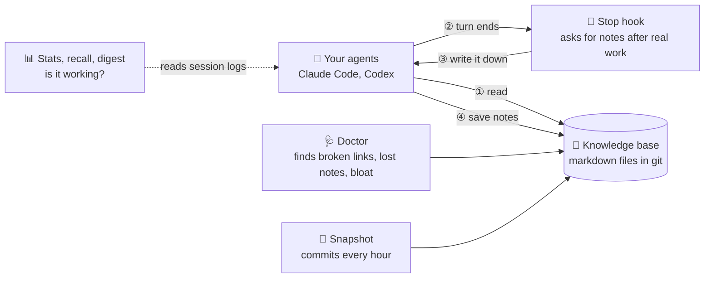
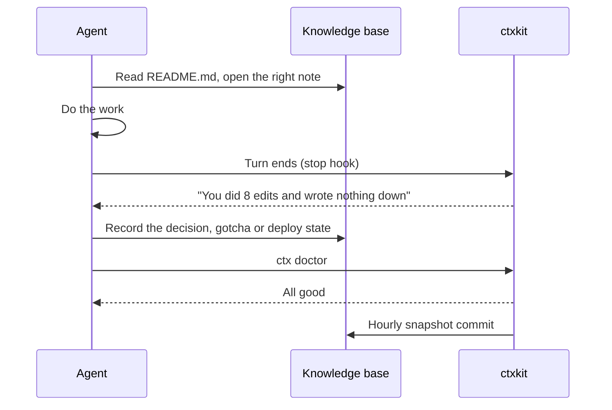

# ctxkit

**A memory for your coding agents, kept in plain markdown files.**

Your agents read a folder of notes before they work and write new notes when they learn something. ctxkit keeps that folder healthy, makes sure nothing in it gets lost, and shows you whether the agents actually use it.

It works with **Claude Code** and **Codex**. It is one small command, `ctx`, with no dependencies beyond Python.

---

## 🚀 Quickstart

```bash
pipx install git+https://github.com/1337mus/ctxkit && ctx init
```

That creates your knowledge base at `~/.agent-context` and prints a short snippet. Paste the snippet into the `AGENTS.md` or `CLAUDE.md` your agent reads. You are done.


---

## 📈 Results

Measured over 11 weeks of daily use with Claude Code and Codex.

| | |
| --- | --- |
| 🧠 **100% recall** | Fresh agents found **12 of 12** stored facts, in about **7 seconds** each |
| 📖 **Up to 80%** of sessions | open the notes on their own, with no reminder in the prompt |
| ✂️ **71% less** to load | Index and rules a coding session reads dropped from **~49k to ~15k tokens** |
| ✍️ **92 → 528 notes** | written by the agents themselves as they worked |
| 🛡️ **Silent deletions caught** | Lost ticket references, deploy records and a rule cut by 62% were found and restored |
| 📚 **62%** of sessions | read the standing rules file |

---

## 🧭 How it works



There are three parts:

- **The knowledge base** is a folder of markdown files in git. You own it. You can read it, edit it and grep it.
- **The agents** read the index first, then open only the notes they need.
- **ctxkit** sits beside both. It reminds agents to write things down, checks the folder for damage, commits it, and measures how well it is working.

ctxkit never puts text into an agent's prompt. The agent decides what to read.

### One session, step by step



---

## 🤔 Why use it

Coding agents forget everything between sessions. You explain the same decisions again, and they repeat mistakes that were already solved.

Most memory tools search old notes and inject the top matches into every prompt. Before building ctxkit, that approach was measured side by side with letting the agent read for itself:

| Approach | Result |
| --- | --- |
| Inject search results into every prompt | Right context only **7%** of the time |
| **ctxkit: agent reads an index and opens what it needs** | Agents used the notes in **68% → 80%** of sessions |

ctxkit keeps that simple approach and fixes the parts that usually break it:

- 🔔 Agents forget to write things down. **The stop hook reminds them.**
- 🛡️ Notes get deleted during routine edits. **Doctor catches it and shows how to restore.**
- 📉 The index grows until it is too expensive to read. **Doctor stops it at a budget.**
- 📊 Nobody knows if it works. **Stats, recall and a weekly digest tell you.**

---

## ✅ Advantages

- **Nothing to run.** No database, no server, no embeddings, no API keys.
- **You can read everything.** It is just markdown in git. If ctxkit disappeared tomorrow, your notes would still be there.
- **Nothing gets lost quietly.** If a ticket key or a rule disappears from the whole folder, `ctx doctor` fails and tells you how to get it back.
- **Agents write as they go.** The stop hook asks for notes after real work, not only at the end of a session.
- **You get real numbers.** How often agents read the notes, which notes matter, and whether a fresh agent can find a stored fact.
- **It works across tools.** Claude Code and Codex share one knowledge base.
- **Nothing touches your prompts.** Unrelated text can't distract the agent, because ctxkit adds none.

---

## 🎯 When to use it

- ✅ You use coding agents every day on the same projects
- ✅ You keep re-explaining decisions, setups or past incidents
- ✅ You run more than one agent tool and want them to share what they know
- ✅ You want memory you can read, grep and fix by hand
- ✅ You want proof it works, not just a feeling

It is built for one developer's agents. For a shared team wiki, point your agents at that instead.

---

## 🛠️ Commands

You mostly need the first two.

| Command | What it does |
| --- | --- |
| `ctx init` | Create a knowledge base and print the agent snippet |
| `ctx doctor` | Check the folder for broken links, lost notes and bloat |
| `ctx stats` | Show how often agents read the notes and which ones |
| `ctx recall build` then `ctx recall run` | Quiz a fresh agent on facts from your notes |
| `ctx digest` | Write a one-page weekly health report |
| `ctx snapshot` | Commit the folder, unless something was lost |
| `ctx hook stop` | The stop hook your agent tool calls |
| `ctx schedule print --launchd` | Print scheduler files for the daily, hourly and weekly jobs (optional) |

---

## 📚 Learn more

- [docs/reference.md](docs/reference.md): every command and check in detail
- [docs/integrations.md](docs/integrations.md): wiring the hook into Claude Code and Codex
- [docs/design.md](docs/design.md): the lessons behind the design
- [examples/config.toml](examples/config.toml): every setting, with its default and the reason for it

---

## 🖥️ Requirements

Python 3.11 or newer and git. Runs on macOS and Linux. Works with Claude Code and Codex.

**License:** to be decided before public release.
